<div align="center">

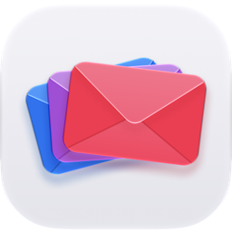

# Goodmail

**A fast, simple and beautiful native mail app for iPhone and iPad.**
Gmail, Outlook, iCloud and any IMAP account, in one calm inbox.

<sub>Swift 6.4 · SwiftUI and UIKit · iOS 27 · English and Hebrew</sub>

</div>

<p align="center">
  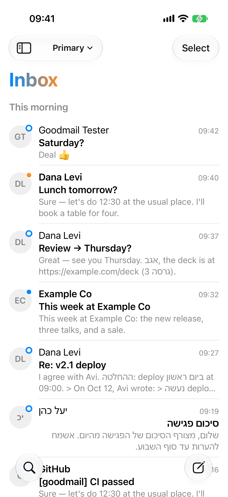
  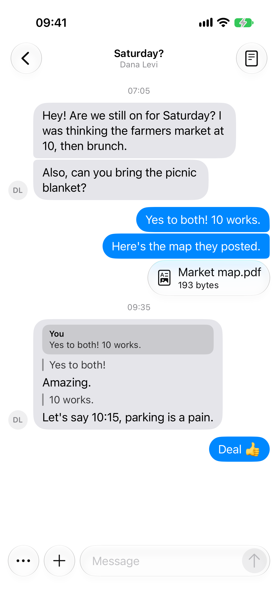
  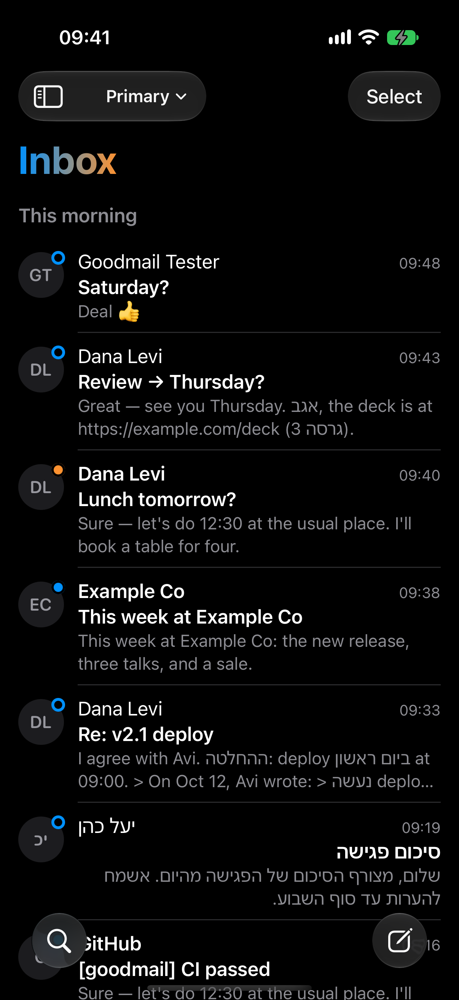
  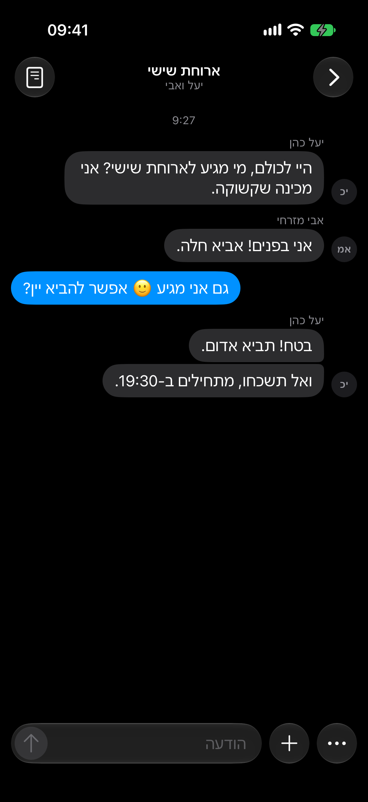
</p>

> [!IMPORTANT]
> **This is a personal app.** I built Goodmail for myself, to read my own mail the way I want to. It is not a product, it is not on the App Store, and nobody supports it.
>
> **This repository is public for one reason only:** public repositories get free, unlimited GitHub Actions minutes, and the build and review pipeline runs on every change. Being public is not an invitation to use, copy, fork or contribute.
>
> **All rights reserved.** No license is granted to use, copy, modify, distribute or commercially exploit any of this code. See [LICENSE](LICENSE). If you use any of it anyway, you do so entirely at your own risk and responsibility: it comes with no warranty, and it can lose, delete or missend mail.

## Why

Apple Mail has no push for Gmail. Gmail's own app is cluttered. Most other clients sell AI and subscriptions, and do too much. Goodmail is simple, lean and quick, built with vanilla Apple components and the Human Interface Guidelines, with craft in the details: animations, haptics, right-to-left text, and an inbox that opens instantly and scrolls 50,000 threads without a hitch.

## Features

### Every account, one inbox

- **Gmail** through the Gmail API, **Outlook** through Microsoft Graph, **iCloud Mail** and **any other IMAP/SMTP account**, with its own server settings editor.
- **Unified inbox** across every account, with a color per account and a gradient through all of them on the views that span accounts.
- **Mailboxes** for each account: Inbox, Starred, Sent, Drafts, All Mail, Spam, Trash, Snoozed and Scheduled, plus labels and folders (nested too) in their own colors. Create, rename and delete labels on every service.
- **Gmail categories** (Primary, Promotions, Social, Updates, Forums), chosen per account.
- **Push**: new mail alerts within seconds, through a tiny Cloudflare Worker that sends a content-free nudge. For iCloud and other IMAP accounts the Worker watches the Inbox itself, since those servers don't push to other apps. Mail is fetched on the device and never touches the server. Alerts per account (All, Primary Only, None) with Reply, Mark as Read, Archive and Trash actions.
- **Instant IMAP**: IMAP IDLE keeps iCloud and IMAP inboxes live while the app is open.
- **Offline first**: everything is cached locally in SQLite, and actions queue in an outbox until the network comes back.

<p align="center">
  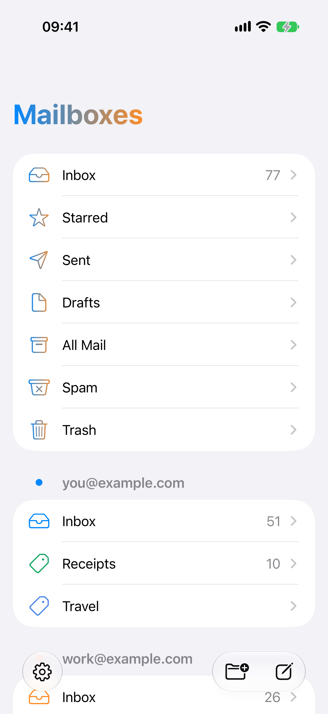
  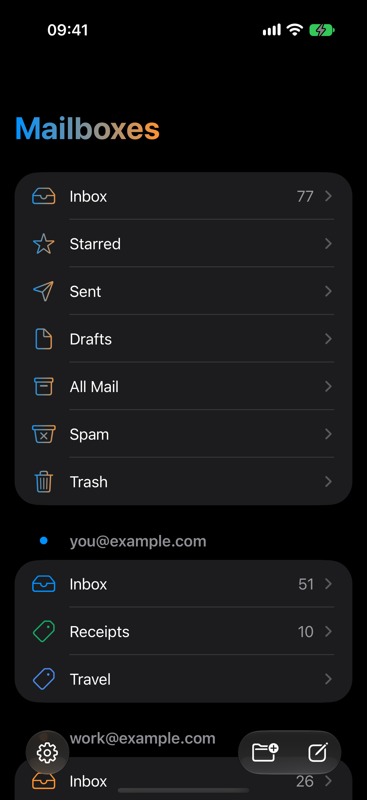
  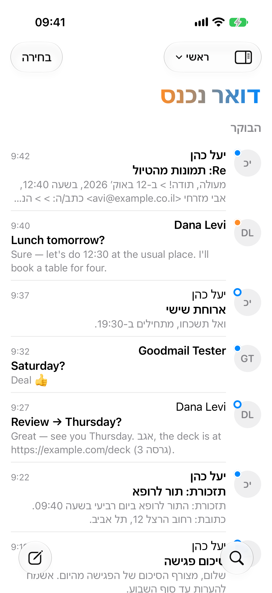
</p>

### Reading

- **Chat view**: a conversation reads as a chat of bubbles, mine on my side, quotes and signatures folded away. Or switch it to classic letters, per conversation or for all of them.
- **Privacy by default**: remote images and tracking pixels are blocked, with "Always Load from This Sender" for the ones you trust.
- **One-tap Unsubscribe** from mailing lists (RFC 8058 one-click, mailto or the list's page).
- **Share or print** a whole conversation, as a PDF, plain text, `.eml` files or an `.mbox` archive.
- **Right to left done right**: every paragraph, quote and list takes its own direction, so Hebrew and English mix cleanly in the reader and the composer.

### Acting on mail

- **Swipe actions** in Liquid Glass, with a full swipe for the first one. Arrange which actions go on each side in Settings.
- **Delightful removals**: archived and trashed mail flies into a box whose lid opens for it, and mail deleted forever dissolves into dust. Works for one row or a whole selection, with a subtle option and full Reduce Motion support.
- **Haptics** on every action that lands.
- **Snooze** until this evening, tomorrow, the weekend, next week or any time. Snoozed mail comes back to the top of the Inbox, unread, with an alert.
- **Pin** important threads to the top of every list, and **Mute** noisy ones, on every service.
- **Multi-select** with Select All: archive, trash, move, label, mark read or unread, snooze.
- **Undo everything**: a toast after each action, or shake to undo.
- **Delete Forever** from Trash and Spam, and Empty Trash.

<p align="center">
  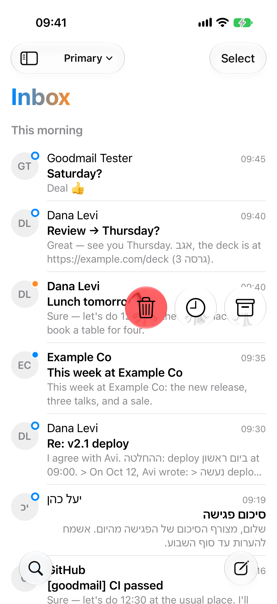
  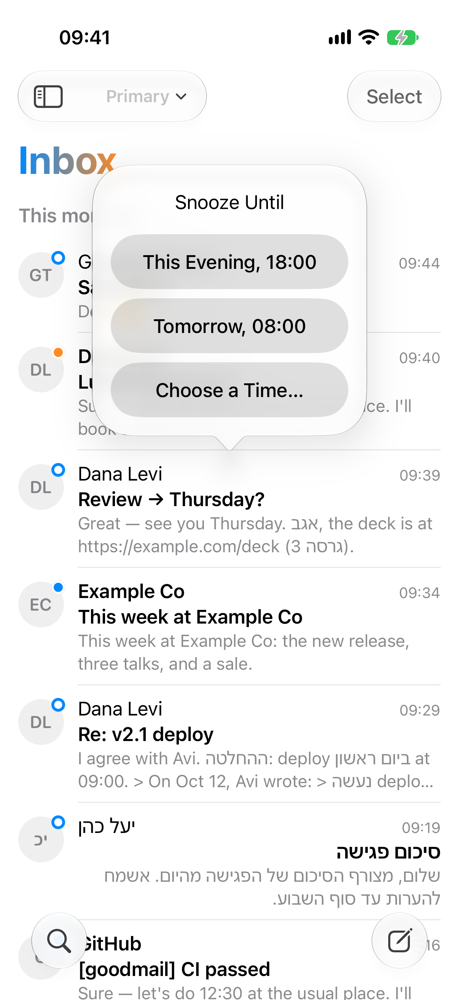
  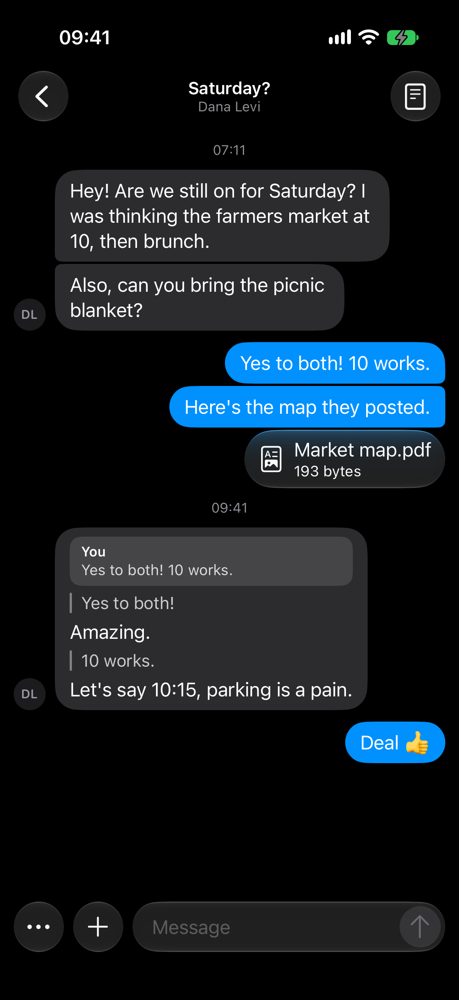
</p>

### Writing

- **A rich text composer** with a formatting bar: bold, italic, underline, strikethrough, lists, quotes, links and each paragraph's direction. Sent as clean, email-safe HTML that renders right in Gmail, Apple Mail and Outlook.
- **Undo Send**, from off up to 30 seconds, and **Scheduled Send**: touch and hold Send for tonight, tomorrow morning, after the weekend or any time.
- **Reliable sending** over a background session that keeps going when the app is suspended or closed, and never sends twice.
- **Attachments** from Photos, Files, the camera or the document scanner. Forward with the original's attachments, **Forward as Attachment**, or **Edit as New**.
- **Recipients** suggested from the people who write to you, your Contacts and Google Contacts.
- **Signatures** per account, **Gmail send-as aliases**, drafts synced to Gmail, and Gmail's **automatic reply**.

<p align="center">
  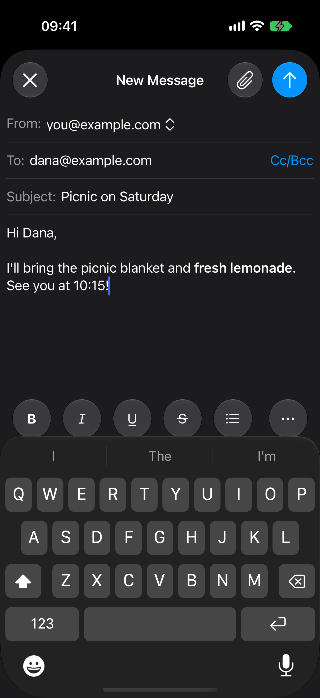
  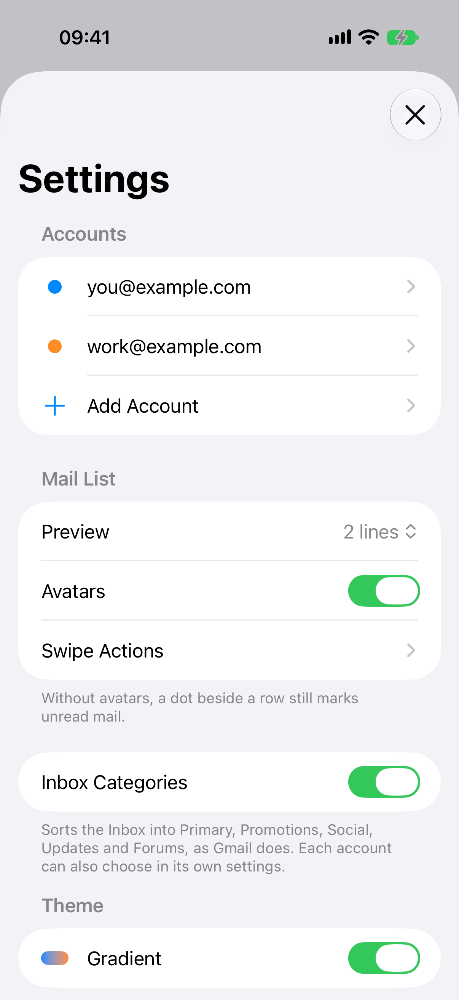
</p>

### Part of the system

- **Interactive widgets**: the Inbox on the Home Screen, with Archive right in the widget.
- **Apple Watch**: the Inbox on the wrist, relayed by the iPhone, with swipes and Undo, conversations as chat bubbles, Reply by dictation or quick replies, Snooze and Pin, one-time codes shown big, and complications and a Smart Stack card that open the conversation they show. Alerts tapped on the watch open there too. With Mail Without iPhone (on by default), the watch reads Gmail and Outlook itself, checks in the background, and gets its own alerts when the iPhone is off or out of reach.
- **App Intents and Shortcuts** in English and Hebrew: write a message, open the Inbox or any mailbox, and act on mail from Siri and Shortcuts, with Undo.
- **Spotlight** search of your threads, **Handoff**, and window state restoration.
- **Default mail app**: `mailto:` links open Goodmail's composer.
- **App icon badge** per account, and server-side **search** with recent searches, search tokens and Gmail operators.
- **iPad** with a sidebar and columns, resizable windows and Open in New Window.
- **Accessibility and localization** built in: Dynamic Type up to the largest sizes, VoiceOver, and English and Hebrew polished end to end.
- **Account health**: sign-in and sync problems show in the toolbar, with a fix one tap away.

## Privacy

Credentials (OAuth tokens and app passwords) live in the device's Keychain. There is no analytics, no telemetry and no AI of its own. The push relay stores which device to wake for which account, with addresses only as keyed hashes. So it can tell when new mail arrives, it also keeps each Gmail account's refresh token and each iCloud or IMAP login, encrypted with AES-GCM. It uses them only to tell that new mail reached the Inbox and to read its sender and subject for the alert, and it never reads a body or stores mail. With Mail Without iPhone on, the Apple Watch gets the iPhone's Gmail and Outlook sign-ins through iCloud Keychain and talks to those providers directly. See [docs/release/privacy.md](docs/release/privacy.md).

## How it's built

Goodmail is a thin app over local Swift packages, one per module:

| Package | What it does |
|---|---|
| `MailCore` | The model and the `MailProvider` abstraction every service implements |
| `MailStore` | SQLite through GRDB: the cache, full-text search, the outbox and the send queue |
| `GmailProvider`, `OutlookProvider`, `IMAPProvider` | Gmail API, Microsoft Graph, and IMAP/SMTP (iCloud and other accounts) |
| `MailUI` | Every screen: the mailbox lists, the reader, the composer, settings |
| `MailIntents` | App Intents, App Shortcuts and Spotlight |
| `MailNotifications` | Building alerts in the Notification Service Extension |

The push relay is a Cloudflare Worker in TypeScript, in [`PushWorker`](PushWorker/README.md). State is modelled explicitly as enums with one place that makes transitions, network and database work never runs on the main actor, and no file is over 1000 lines.

More in [docs/product-brief.md](docs/product-brief.md), [docs/architecture/decisions.md](docs/architecture/decisions.md), [docs/design/design-decisions.md](docs/design/design-decisions.md) and [docs/plan/v1-plan.md](docs/plan/v1-plan.md).

## Development

These notes are for me and the agents that work on Goodmail with me.

Requires Xcode 27.2 / Swift 6.4.

### Tooling

Claude Code tooling is declared in the repo:

- `.claude/settings.json` enables these plugins, and Claude Code asks you to install them when you open the folder:
  - [pstack](https://github.com/michael-denyer/pstack-claude)
  - Antoine van der Lee's Swift skills: [SwiftUI](https://github.com/AvdLee/SwiftUI-Agent-Skill), [Swift Concurrency](https://github.com/AvdLee/Swift-Concurrency-Agent-Skill), [Swift Testing](https://github.com/AvdLee/Swift-Testing-Agent-Skill), [Core Data](https://github.com/AvdLee/Core-Data-Agent-Skill), [Xcode Build Optimization](https://github.com/AvdLee/Xcode-Build-Optimization-Agent-Skill)
- `.mcp.json` registers Xcode's MCP bridge (`xcrun mcpbridge`). It covers builds, previews, documentation search and String Catalog tools, and works only while Xcode has the project open.
- `scripts/sync-xcode-skills.sh` copies the agent skills that ship with the active Xcode, currently String Catalog translation, into `.claude/skills/`. Run it after cloning and after each Xcode update.

### Building and the gate

- Open `Goodmail.xcodeproj` (JSON project format). Code lives in local packages under `Packages/`; the app, `NotificationService` and `Widgets` targets are thin.
- `scripts/check` is the gate: swift-format lint, the 1000-line cap, a check that no App Intent text says "Siri" (App Store Connect rejects those uploads), package tests and the app's English/Hebrew launch tests. `scripts/check --lint` runs only the fast part. Its tests run on a separate "Goodmail Check" simulator. On the Mac, install simslim so simulators run lighter, and read [docs/setup/mac-simulators.md](docs/setup/mac-simulators.md) before booting or slimming one.
- `scripts/record-fixtures` files the `TestMail` corpus into the signed-in test account and records Gmail's responses as fixtures (ADR-010). `TestMail/generate.py` writes the corpus.
- `scripts/run` builds the signed Debug app and installs it on the dev simulator, keeping its Gmail sign-in. Arguments pass through to the app, e.g. `scripts/run -AppleLanguages "(he)"`.
- Debug builds launched with `-GoodmailSyntheticThreads 300 -GoodmailSyntheticCorpus <repo>/TestMail` show a demo mailbox with no sign-in. The screenshots in `docs/screenshots` come from it, so they hold no real mail.
- Claude cloud sessions (Linux) compile the packages and their tests for iOS with xtool (`scripts/ios-build`) and run the MailCore, GmailProvider, IMAPProvider, OutlookProvider, MailStore and PlaneGame tests natively; `scripts/check` does both there. Setup is automatic: see [docs/setup/cloud-builds.md](docs/setup/cloud-builds.md).
- `scripts/testflight` archives a signed Release build of the current commit and uploads it with `asc`, the App Store Connect CLI. App Store Connect picks the build number. Every build goes to the internal "Internal" TestFlight group, which has access to all builds, and `scripts/public-beta` then submits it to the public beta, the external "Apple Review" group: see [docs/setup/testflight.md](docs/setup/testflight.md). It needs Xcode signed in to the team and `asc auth status` showing an API key.
- After cloning, enable the tracked hooks (pre-commit runs `--lint`, pre-push runs everything):

  ```bash
  git config core.hooksPath .githooks
  ```

### How changes land

Each change is a small pull request that passes `scripts/check`, gets a Claude review against [docs/review.md](docs/review.md), and is landed by the merge queue ([docs/setup/merge-queue.md](docs/setup/merge-queue.md)).

## License

Copyright © 2026 shinycake. **All rights reserved.** This is proprietary software: no permission is granted to use, copy, modify, distribute or commercially exploit it, and it is provided as is, without any warranty. See [LICENSE](LICENSE).

Third-party components keep their own licenses: see [THIRD_PARTY_NOTICES.md](THIRD_PARTY_NOTICES.md). Gmail, Outlook and iCloud are trademarks of their owners, and Goodmail is not affiliated with them.
